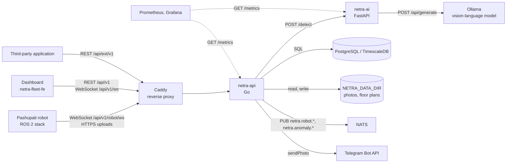
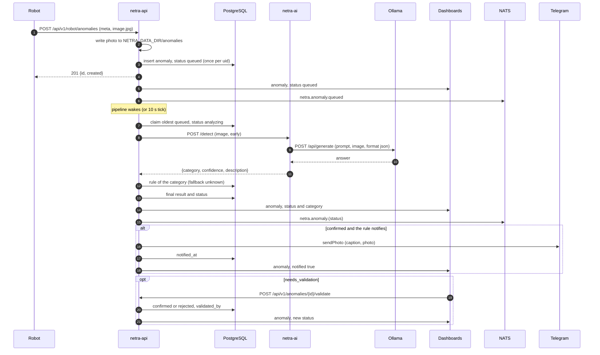
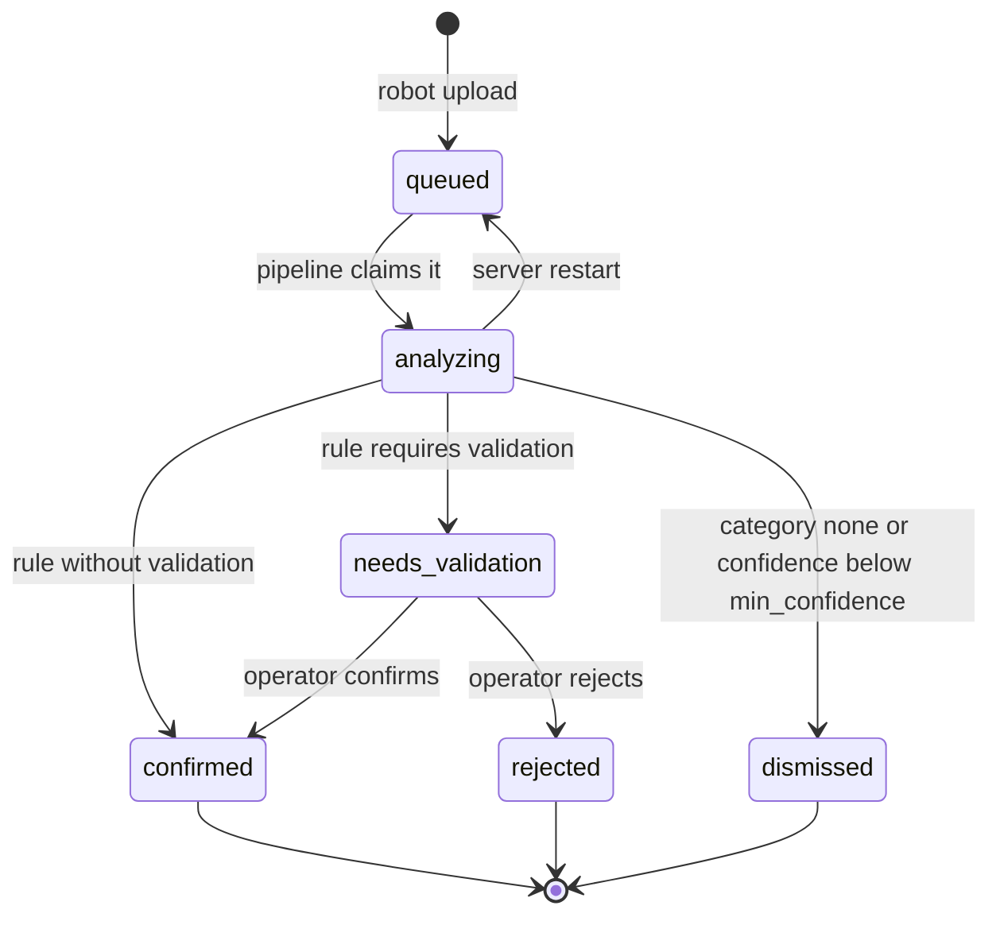
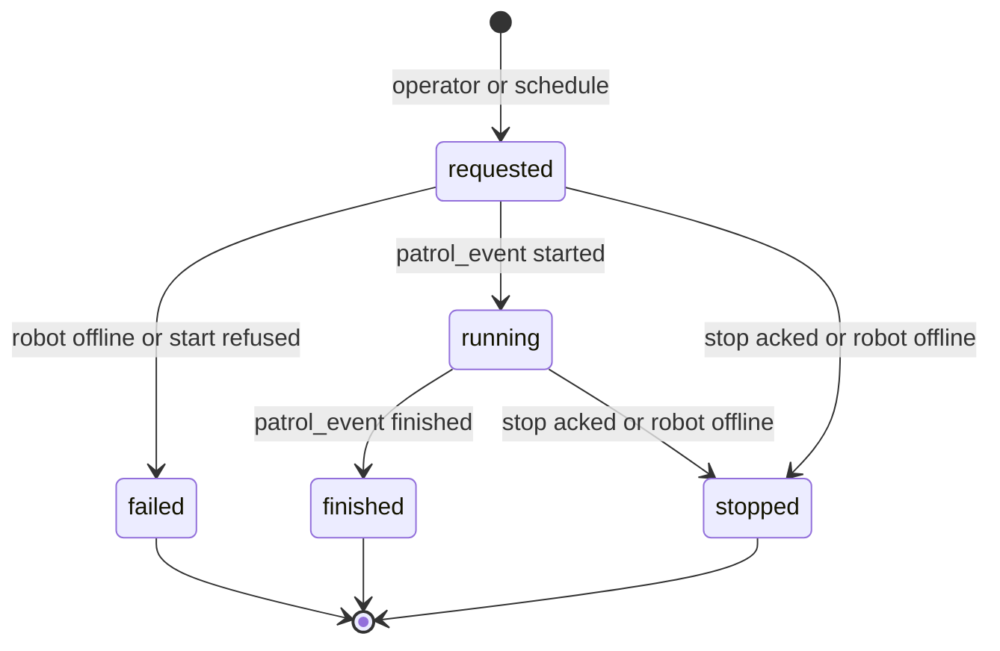

# Architecture

NETRA Fleet is the patrol command center (EZRA Robotics) for Pashupati quadruped patrol robots. This
repository holds two services: `netra-api`, the Go service every client talks to, and `netra-ai`, a
FastAPI service that `netra-api` calls for the final classification of anomaly photos. The
deployment (docker compose with TimescaleDB, NATS, Ollama, Caddy, Prometheus and Grafana) lives in
the [Netra](https://github.com/DarmawanWeb/Netra) repository.

## Components

| Component | Source | Role |
|---|---|---|
| `netra-api` | this repository: [`cmd/netra-api`](../cmd/netra-api/main.go), `internal/` | Dashboard REST and WebSocket API, robot gateway, anomaly pipeline, scheduler, reports, integration API, metrics |
| `netra-ai` | this repository: [`ai/`](../ai/netra_ai/main.py) | Final anomaly detection with a vision-language model on Ollama ([AI service](ai-service.md)) |
| PostgreSQL / TimescaleDB | deployment | All state; `netra-api` applies its own migrations ([database](database.md)) |
| `NETRA_DATA_DIR` | `netra-api` volume | Anomaly photos and floor-plan files |
| NATS | deployment, optional | Receives the domain events `netra-api` publishes; nothing in this repository subscribes |
| Ollama | deployment | Runs the vision-language model for `netra-ai` |
| Robots | [Pashupati](https://github.com/DarmawanRobotics/Pashupati/blob/main/src/robot_fleet/API.md) | Connect with a robot token: WebSocket for telemetry, events and commands, HTTPS for uploads |
| Dashboard | DarmawanWeb/netra-fleet-fe (Next.js) | Operator UI: REST with a session token, live WebSocket feed |
| Telegram | Bot API | Photo alerts for confirmed anomalies |
| Caddy, Prometheus, Grafana | deployment | Reverse proxy (`netra-api` reads `X-Forwarded-For`, `X-Forwarded-Proto`, `X-Forwarded-Host`); metrics |



### Process layout

[`cmd/netra-api/main.go`](../cmd/netra-api/main.go) wires the process:

1. `config.Load` reads the environment ([configuration](configuration.md)).
2. `store.Open` connects to PostgreSQL, retrying once a second for about 30 s, and applies the
   embedded migrations.
3. If `NETRA_ADMIN_PASSWORD` is set, the user `NETRA_ADMIN_USER` is created or updated with that
   password and the `admin` role (on every start).
4. The final detector is `detect.HTTP` (calls `netra-ai`) when `NETRA_FINAL_DETECTOR_URL` is set,
   else `detect.PassThrough`, which returns the robot's own result.
5. `api.New` builds the server with the WebSocket hub, the Telegram notifier and the NATS
   publisher. Two goroutines start: the anomaly pipeline (`Server.RunPipeline`) and the scheduler
   (`scheduler.Run`).
6. The HTTP server listens on `NETRA_ADDR` (`ReadHeaderTimeout` 10 s, no read or write timeout).
   SIGINT or SIGTERM shuts it down with a 10 s grace period.

Live state is held in process memory: WebSocket connections, commands waiting for an ack, robot
clock offsets, the telemetry sampling clock, the login throttle and the integration rate limits.
Nothing shares it between processes; a command, for example, only reaches a robot connected to the
same `netra-api` process.

## Package map

| Package | Responsibility | Key files |
|---|---|---|
| `cmd/netra-api` | Entry point: wiring, background goroutines, graceful shutdown | [`main.go`](../cmd/netra-api/main.go) |
| `internal/api` | Dashboard REST API and live feed, robot gateway (WebSocket, uploads), commands and acks, clock-skew correction, anomaly pipeline, patrol start, report endpoints, users and sessions, audit, integration-client admin | [`server.go`](../internal/api/server.go) (routes, middleware, helpers), [`dashboard.go`](../internal/api/dashboard.go), [`robot.go`](../internal/api/robot.go), [`robotcontrol.go`](../internal/api/robotcontrol.go), [`clock.go`](../internal/api/clock.go), [`pipeline.go`](../internal/api/pipeline.go), [`reports.go`](../internal/api/reports.go), [`users.go`](../internal/api/users.go), [`clients.go`](../internal/api/clients.go) |
| `internal/auth` | PBKDF2-SHA256 password hashes, random tokens and their SHA-256 digests, roles and permissions | [`auth.go`](../internal/auth/auth.go), [`rbac.go`](../internal/auth/rbac.go) |
| `internal/bus` | Publish-only NATS client over the core text protocol, reconnects lazily | [`nats.go`](../internal/bus/nats.go) |
| `internal/config` | Environment variables into `config.Config` | [`config.go`](../internal/config/config.go) |
| `internal/detect` | `Detector` interface, `PassThrough`, `HTTP` client for `netra-ai` | [`detect.go`](../internal/detect/detect.go) |
| `internal/ext` | Integration API `/api/ext/v1`: client credentials, scopes, rate limits, anomaly change feed, fleet data, embedded OpenAPI and Swagger UI | [`ext.go`](../internal/ext/ext.go), [`token.go`](../internal/ext/token.go), [`anomalies.go`](../internal/ext/anomalies.go), [`fleet.go`](../internal/ext/fleet.go), [`limit.go`](../internal/ext/limit.go), [`docs.go`](../internal/ext/docs.go), [`docs/openapi.yaml`](../internal/ext/docs/openapi.yaml) |
| `internal/hub` | Robot and dashboard WebSocket connections: one writer goroutine each, keep-alive pings, broadcast | [`hub.go`](../internal/hub/hub.go) |
| `internal/i18n` | English and Indonesian texts for reports and Telegram captions, category labels | [`i18n.go`](../internal/i18n/i18n.go) |
| `internal/metrics` | Minimal Prometheus registry (counters, gauges) and the HTTP middleware | [`metrics.go`](../internal/metrics/metrics.go) |
| `internal/notify` | Telegram `sendPhoto` client | [`telegram.go`](../internal/notify/telegram.go) |
| `internal/report` | PDF (go-pdf/fpdf) and XLSX (hand-written OOXML) writers | [`pdf.go`](../internal/report/pdf.go), [`xlsx.go`](../internal/report/xlsx.go) |
| `internal/scheduler` | Starts patrols from weekly and one-off schedules | [`scheduler.go`](../internal/scheduler/scheduler.go) |
| `internal/store` | PostgreSQL access (`database/sql`, `lib/pq`), embedded migrations, models and queries, route CSV parsing, integration feed queries | [`store.go`](../internal/store/store.go), [`models.go`](../internal/store/models.go), [`queries.go`](../internal/store/queries.go), [`users.go`](../internal/store/users.go), [`clients.go`](../internal/store/clients.go), [`feed.go`](../internal/store/feed.go), [`routecsv.go`](../internal/store/routecsv.go), `migrations/` |

## Request lifecycle

```text
http.Server                 ReadHeaderTimeout 10 s
└─ metrics.Middleware       counts each request per mux pattern and status class
   └─ cors                  CORS headers on every answer, OPTIONS answered with 204
      └─ http.ServeMux      Go 1.22 patterns, e.g. "GET /api/v1/robots/{id}/track"
         ├─ no auth         GET /healthz, POST /api/v1/auth/login, GET /metrics, integration token and docs
         ├─ requireUser     dashboard routes, one permission each
         ├─ requireRobot    /api/v1/robot/... routes
         └─ ext.require     integration routes, one scope each
```

Every route is registered in `Server.Handler` ([`server.go`](../internal/api/server.go)); the
reference is [api.md](api.md). CORS sets `Access-Control-Allow-Origin` to `NETRA_ALLOWED_ORIGIN`,
allows the headers `Authorization, Content-Type` and the methods `GET, POST, PUT, DELETE, OPTIONS`,
and answers preflight requests before any authentication. Handlers decode JSON bodies of at most
1 MiB, answer JSON, and report errors as `{"error": "<message>"}`; `fail` maps
`store.ErrNotFound` to 404 and any other error to 500 with the error text.

### Sessions and passwords

`POST /api/v1/auth/login` checks the password and returns a session token: 32 random bytes,
base64url. Only its SHA-256 hex digest is stored (`sessions.token_hash`), with
`expires_at = now + NETRA_SESSION_HOURS` and the client IP. `requireUser` reads the token from
`Authorization: Bearer <token>` or from `?token=` (browsers cannot set headers on WebSockets,
images and downloads), looks up a session that has not expired and whose user is not disabled
(401 `login required` otherwise), then checks the route's permission (403
`your role cannot do this`) and puts the user in the request context.

- Logout deletes the session. Disabling a user or resetting their password deletes all their
  sessions; changing one's own password keeps only the current one. Expired sessions are filtered
  out but never deleted.
- Passwords are PBKDF2-HMAC-SHA256 with 210 000 iterations and a 16-byte salt, stored as
  `pbkdf2-sha256$<iterations>$<salt>$<hash>` (base64), compared in constant time.
- Login throttling: 8 failed logins from one IP within 10 minutes block logins from that IP (429)
  until the oldest failure leaves the window. A failure also waits 400 ms; a success clears the
  IP's failures. The IP is the first `X-Forwarded-For` entry, else the connection address. The
  counters are in memory.

### Roles and permissions

Defined in [`rbac.go`](../internal/auth/rbac.go):

| Permission | Allows | viewer | operator | supervisor | admin |
|---|---|---|---|---|---|
| `view` | Read every page, live feed, reports, own account | yes | yes | yes | yes |
| `operate` | Patrols, schedules, robot commands, anomaly validation | | yes | yes | yes |
| `configure` | Robots and robot tokens, routes, rules, floor plans | | | yes | yes |
| `audit` | Audit log | | | yes | yes |
| `users` | Users and integration API clients | | | | yes |

The last enabled admin cannot be demoted, disabled or deleted, and nobody can delete their own
account (`keepOneAdmin` in [`users.go`](../internal/api/users.go)).

### Audit log

Entries go to the `audit_log` table and are read with `GET /api/v1/audit` (permission `audit`):

- every dashboard request that is not `GET` or `HEAD` and ends with a status below 400, as action
  `<METHOD> <path>` with the concrete path (for example `POST /api/v1/robots/l1w-01/command`), the
  username and the IP;
- `login` and `login_failed` (with the submitted username);
- descriptive entries with a target and JSON detail, written by some handlers in addition to the
  generic one: `robot.inspection` and `robot.people` (also when the robot refused, timed out or was
  offline), `api_client.create`, `api_client.update`, `api_client.rotate_secret`,
  `api_client.delete`;
- `ext.token` for each integration access token issued, with username `api:<client_id>`.

Entries are written in a goroutine with a 5 s timeout; a failed write is only logged.

## Robot connection lifecycle

The robot side of the protocol is specified in the
[Pashupati robot API](https://github.com/DarmawanRobotics/Pashupati/blob/main/src/robot_fleet/API.md).
This section describes what the server does.

### Robot token

A user with `configure` registers a robot (`POST /api/v1/robots`, ID matching
`^[a-z0-9][a-z0-9_-]{1,31}$`). The response carries the robot token once; the database keeps its
SHA-256 digest (`robots.token_hash`). `POST /api/v1/robots/{id}/token` issues a new one.
`requireRobot` accepts the token as `Authorization: Bearer` (or `?token=`) and, when the robot sends
`X-Robot-Id`, requires it to match the token's robot (403 otherwise). The token is checked when a
request starts only: rotating it or deleting the robot does not close a WebSocket that is already
open.

### WebSocket session

`GET /api/v1/robot/ws` ([`robot.go`](../internal/api/robot.go), [`hub.go`](../internal/hub/hub.go)):

- The connection is upgraded (origin not checked) and registered in the hub under the robot ID; a
  newer connection of the same robot closes the older one.
- On connect `netra_robot_online{robot}` becomes 1 and dashboards get `robot_online` `true`; on
  disconnect the gauge becomes 0 and dashboards get `robot_online` `false`.
- Messages are limited to 1 MiB. The read deadline is 90 s and is renewed by every data message, so
  a robot has to send something (telemetry is sent at 1 Hz) at least every 90 s; pong frames do not
  renew it.
- The hub's writer sends a ping every 20 s with a 10 s write deadline. Outgoing messages wait in a
  queue of 256 and are dropped when it is full.

Each message is decoded as JSON (invalid JSON is ignored) and handled by `type`. Every handled
message is then broadcast to dashboards as `{"type", "robot_id", "data"}`, published on NATS as
`netra.robot.<robot_id>.<type>` and counted in `netra_robot_messages_total{type}`. Unknown types
are dropped before these steps.

| `type` | Fields the server reads | Effect |
|---|---|---|
| `hello` | none | Only the common steps |
| `telemetry` | `ts`, `pose {x, y, yaw}`, `mode`, `nav.state`, `battery.pct`, `people`, `health {cpu_percent, gpu_percent, memory_percent, memory_used_gb, memory_total_gb, cpu_temp_c}`, `patrol_id` | Measures the clock offset from `ts`; stores the whole message in `robots.last_telemetry` and sets `last_seen`; at most once per 5 s per robot writes a `telemetry` history row and sets `netra_robot_battery_percent` |
| `patrol_event` | `event`, `lap`, `reason`, `patrol_id` | With a patrol ID: `started` sets the patrol `running`, `lap` raises `laps`, `finished` sets `finished` with `reason` as message; always stored in `events` |
| `stop_event`, `alert` | `patrol_id` | Stored in `events` as received |
| `crowd` | `ts_start`, `ts_end`, `cell_size`, `cells`, `peak_people`, `patrol_id` | Stored in `crowd_samples` with corrected times |
| `ack` | `id`, `ok`, `msg` | Resolves a pending command |

A missing `patrol_id`, or one of 0 or below, means the message belongs to no patrol.

### Commands and acks

The server sends `{"type": "command", "id": "<name>-<unix ns>", "name": "<name>", "args": {...}}`
and keeps the ID in a pending map until the robot answers
`{"type": "ack", "id": "<same id>", "ok": true|false, "msg": "..."}`.

| Command | `args` | Sent by | What the ack does |
|---|---|---|---|
| `start_patrol` | `route_id`, `patrol_id` | `POST /api/v1/patrols`, scheduler | `ok: false` sets the patrol `failed` with `msg` |
| `stop_patrol` | none | `POST /api/v1/patrols/{id}/stop` | `ok: true` sets the patrol `stopped` (`stopped by operator`) |
| `pause`, `resume`, `localize`, `stop_patrol`, `estop`, `estop_release` | operator's `args`, passed through | `POST /api/v1/robots/{id}/command` | Nothing on the server; dashboards see the `ack` on the live feed |
| `set_inspection` | `enabled`, `model`, `interval` (those given) | `POST /api/v1/robots/{id}/inspection` | Becomes the HTTP answer |
| `set_people` | `enabled` | `POST /api/v1/robots/{id}/people` | Becomes the HTTP answer |

`set_inspection` and `set_people` use `commandAndWait` ([`robotcontrol.go`](../internal/api/robotcontrol.go)):
the request blocks for up to 10 s and answers 200 with `{"ok": true, "msg": "..."}`, 422 with
`{"ok": false, "msg": "..."}` when the robot refused, 504 on timeout and 409 when the robot is
offline.
The other commands do not wait for the ack ([api.md](api.md) lists the status codes). Sending to an
offline robot fails with `robot offline`. Pending entries of commands that are never acked stay in
memory.

### Clock-skew correction

A robot without NTP keeps the clock it booted with ([`clock.go`](../internal/api/clock.go)). For
every `telemetry` message with a positive `ts`, the server records `offset = server time − ts` for
that robot, in memory. Robot timestamps that are stored (anomaly `ts`, crowd `ts_start` and
`ts_end`, route `recorded_at`) are shifted by the offset when it is above 2 s in either direction;
a missing timestamp means the time of arrival. `GET /api/v1/robots` reports the offset as
`clock_skew_s` (seconds, positive when the robot is behind, `null` until the robot has sent
telemetry since the server started). Telemetry history, events and `last_seen` use server time.

### Route uploads

A robot records a teach-and-repeat route and uploads it with `POST /api/v1/robot/routes`
(multipart: `meta` JSON with `uid`, `name`, `recorded_at`, `length_m`, `stops`, `closed`, and the
file field `route.csv` with `x,y,yaw_deg,dwell_sec` rows). The route is stored once per `uid` (a
repeated upload returns the existing ID), and dashboards get a `route` message. The robot fetches
routes it owns with `GET /api/v1/robot/routes/{id}/file`.

## Anomaly pipeline

[`robot.go`](../internal/api/robot.go) receives uploads, [`pipeline.go`](../internal/api/pipeline.go)
runs the final detection and the category rules.

1. **Upload.** `POST /api/v1/robot/anomalies`, multipart: `meta` JSON (`uid` required, `ts`,
   `category`, `confidence`, `description`, `patrol_id`, `route_id`, `stop_index`,
   `pose {x, y, yaw}`) and the file field `image.jpg` (read up to 16 MiB).
2. **Photo storage.** The JPEG is written to
   `NETRA_DATA_DIR/anomalies/<YYYY-MM-DD>/<uid>.jpg` (upload date in the process time zone, base
   name of the uid) before the database insert. The path is stored in `anomalies.image_path`.
3. **Insert.** A row with status `queued`, `detected_at` from the corrected `ts`, the early
   category (`unknown` when empty), confidence, description, position and stop index. The insert
   is idempotent on `uid`: a repeated upload answers the existing ID with `created: false` and
   triggers nothing else.
4. **Queued.** For a new row: live `anomaly` message (`queued`),
   `netra_anomalies_received_total{category}`, NATS `netra.anomaly.queued`, and the pipeline is
   woken.
5. **Claim.** One pipeline goroutine. At start it puts anomalies left in `analyzing` back to
   `queued`. It then claims the oldest `queued` anomaly (`FOR UPDATE SKIP LOCKED`, status
   `analyzing`), processes it, and repeats until none is left; then it waits for the next upload
   or a 10 s tick.
6. **Final detection.** `Detector.Classify(photo, early result)`. With `NETRA_FINAL_DETECTOR_URL`
   it posts the multipart fields `early` (`{"category", "confidence", "description"}`) and `image`
   to `netra-ai` with a 120 s timeout; a status of 300 or above is an error. Without it the early
   result is returned. On error the early result is used and a warning is logged. An empty final
   category becomes the early category.
7. **Rule.** The `anomaly_rules` row of the final category, else the `unknown` rule.
8. **Status.** `dismissed` when the final category is `none` or the confidence is below the rule's
   `min_confidence`; else `confirmed` when the rule does not require validation; else
   `needs_validation`. Final category, confidence, description and status are stored together.
9. **Fan-out.** Live `anomaly` message with status and category, NATS `netra.anomaly.<status>`,
   `netra_anomalies_processed_total{status}`.
10. **Telegram.** For `confirmed`, the photo is sent when the rule has `notify_telegram`, a bot
    token is configured and the anomaly was not notified before. The chat is the rule's
    `telegram_chat_id`, else `NETRA_TELEGRAM_CHAT_ID`. The HTML caption (language `NETRA_LANG`)
    holds the category label, robot ID, detection time in `NETRA_TZ`, position in metres, the
    description and, when `NETRA_PUBLIC_URL` is set, `<NETRA_PUBLIC_URL>/anomalies/<id>`. Success
    stamps `notified_at` and sends a live `anomaly` message with `notified: true`. A failure is
    only logged; the next operator confirmation of the anomaly tries again.
11. **Validation.** For `needs_validation`, an operator calls `POST /api/v1/anomalies/{id}/validate`
    with `confirm` or `reject`, optionally correcting the category and adding a note. The status
    becomes `confirmed` or `rejected` with `validated_by` and `validated_at`, dashboards get an
    `anomaly` message, and a confirmation runs the Telegram step in the background. Operator
    decisions are not published on NATS.
12. **Integration feed.** A trigger moves `anomalies.updated_at` on every update, so each change
    reaches the `/api/ext/v1/anomalies` change feed about 2 s later.

The validate endpoint does not check the current status: a decision can be taken in any status and
changed later. A decision taken while the anomaly is `analyzing` is overwritten by step 8.





The default rules (migration 001, labels from 003) are:

| Category | Label | Requires validation | Telegram | `min_confidence` |
|---|---|---|---|---|
| `trash` | Trash | no | yes | 0.5 |
| `spill` | Spill | no | yes | 0.5 |
| `floor_damage` | Floor damage | yes | yes | 0.5 |
| `fallen_person` | Fallen person | yes | yes | 0.5 |
| `unknown` | Other | yes | no | 0.5 |

Rules are edited with `PUT /api/v1/rules/{category}`; `unknown` is the fallback and cannot be
deleted. The categories `netra-ai` may answer are set by `NETRA_AI_CATEGORIES` and must match the
rule codes.

### Live updates

Every state change above is pushed to the dashboards connected to `GET /api/v1/ws` through
`hub.Broadcast`. The message types are listed in [api.md](api.md#live-websocket-feed).

## NATS events

[`bus.Publisher`](../internal/bus/nats.go) speaks the NATS core protocol over plain TCP (no TLS),
with credentials from the user info of `NETRA_NATS_URL`. It connects on the first publish and
reconnects on a later publish after a write error; after a failed connection attempt it waits 5 s
before the next one. Messages published while disconnected are dropped. An empty `NETRA_NATS_URL`
disables it.

| Subject | Payload | When |
|---|---|---|
| `netra.robot.<robot_id>.<type>` | The robot's WebSocket message as received | Every handled robot message |
| `netra.anomaly.queued` | `{"id", "robot_id", "category"}` (early category) | New anomaly upload |
| `netra.anomaly.needs_validation`, `.confirmed`, `.dismissed` | `{"id", "robot_id", "category", "confidence"}` | After final detection |

## Patrol lifecycle and scheduler

`Server.StartPatrol` ([`robot.go`](../internal/api/robot.go)) serves both `POST /api/v1/patrols`
and the scheduler:

1. load the route, which must belong to the robot;
2. insert a `patrols` row with status `requested` (and the schedule ID when scheduled);
3. send `start_patrol` with `route_id` and `patrol_id`; when the robot is offline the patrol is set
   `failed` (`robot offline`) and the error is returned (HTTP 409);
4. send `patrol_requested` to the dashboards.

The robot reports progress with `patrol_event` messages carrying the patrol ID:

| Status | Set by |
|---|---|
| `requested` | Patrol created |
| `running` | `patrol_event` `started`; stamps `started_at` the first time |
| `finished` | `patrol_event` `finished`; `message` is the robot's `reason` |
| `stopped` | ok ack of the `stop_patrol` sent by `POST /api/v1/patrols/{id}/stop` (`stopped by operator`), or at once when that request finds the robot offline (`robot offline`) |
| `failed` | Robot offline at start, or `start_patrol` acked with `ok: false` (`message` is the robot's `msg`) |

`finished`, `stopped` and `failed` stamp `finished_at`. Transitions are not guarded: the last update
wins. `lap` events raise `laps` (never lower it). A `stop_patrol` sent through
`POST /api/v1/robots/{id}/command` is not linked to a patrol, so the status then only changes
through the robot's own `patrol_event`.



`GET /api/v1/patrols/{id}` adds a recap computed from the database: anomalies per category (all
statuses except `rejected`), events per type (`stop_event` counted by its `event` field, for example
`inspected` and `skipped`), and the crowd peak of the patrol.

### Scheduler

[`scheduler.Run`](../internal/scheduler/scheduler.go) checks all schedules at start-up and then
every 20 s, in `NETRA_TZ`:

- `Due` is true when the schedule is enabled, today matches (`once_on` equals today's date, or
  today's weekday is in `days`, 0 = Sunday) and the time is within 5 minutes after `time_of_day`.
- `MarkScheduleRun` sets `last_run_on` to today only if it is earlier, so a schedule fires at most
  once a day, also across restarts.
- It then calls `StartPatrol` with the schedule ID. A failure (robot offline, route of another
  robot) is logged; the day still counts as run.

A window missed entirely (server down for those 5 minutes) is not caught up. One-off schedules
remain in the table, enabled, after their date.

## Crowd aggregation

Robots count people on a grid and send `crowd` messages: a window (`ts_start`, `ts_end`), a cell
size in metres, `cells` as `[ix, iy, count]` triples and `peak_people`. Each message is one row of
`crowd_samples`. Aggregation happens on request ([`queries.go`](../internal/store/queries.go)):

- `GET /api/v1/crowd/heatmap`: samples whose `ts_start` is in the range (optionally one robot); per
  cell, keyed by `(ix × cell_size, iy × cell_size, cell_size)`: `peak` (highest count), `mean`
  (average count over the samples that contain the cell, two decimals) and `samples`.
- `GET /api/v1/crowd/timeline`: the highest `peak_people` per hour or day, truncated in `NETRA_TZ`.
- The patrol recap and the summary report use the same data (crowd peak per patrol, daily peaks).

## Reports

Reports are generated on request and not stored ([`reports.go`](../internal/api/reports.go),
[`internal/report`](../internal/report/pdf.go)). `lang=id` gives Indonesian, anything else English;
built-in category codes are translated, other categories use their rule label. Times are shown in
`NETRA_TZ`. The underlying queries return at most 500 patrols or anomalies.

| Endpoint | Output | Contents |
|---|---|---|
| `GET /api/v1/reports/patrols/{id}/pdf` | `patrol-<id>.pdf` | Summary (status, robot, start, finish, duration, laps, stops inspected and skipped, anomalies, crowd peak); anomaly table with up to 12 photos (not `rejected` or `dismissed`, JPEG or PNG that decode); event timeline |
| `GET /api/v1/reports/summary` | `netra-summary.pdf` or, with `format=xlsx`, `netra-summary.xlsx` | Patrol and anomaly counts, anomalies per category (without `rejected` and `dismissed`), daily crowd peak, patrol table |
| `GET /api/v1/reports/anomalies` | `anomalies.xlsx` | One row per anomaly: early and final detection with confidences, status, position, note, validator |
| `GET /api/v1/reports/patrols` | `patrols.xlsx` | One row per patrol: robot, start, finish, duration, laps, status, message |

PDFs are A4 with a NETRA header band and a footer with the generation time and page numbers; text
goes through a cp1252 translator for the core Helvetica font. XLSX files are minimal OOXML
packages written by [`xlsx.go`](../internal/report/xlsx.go): inline strings, a styled and frozen
header row, an auto-filter, times as text.

## Metrics

`GET /metrics` serves the in-process registry of [`metrics.go`](../internal/metrics/metrics.go) in
the Prometheus text format, without authentication. Values reset when the process restarts.

| Metric | Type | Labels | Meaning |
|---|---|---|---|
| `netra_http_requests_total` | counter | `route` (mux pattern or `unmatched`), `code` (`2xx`, `4xx`, ...) | HTTP requests |
| `netra_http_request_seconds_sum` | counter | `route` | Total time spent in requests, seconds (WebSocket sessions count their whole duration) |
| `netra_robot_online` | gauge | `robot` | 1 while the robot's WebSocket is connected |
| `netra_robot_messages_total` | counter | `type` | Robot WebSocket messages handled |
| `netra_robot_battery_percent` | gauge | `robot` | Battery from the 5 s telemetry sample |
| `netra_anomalies_received_total` | counter | `category` (robot's) | New anomaly uploads |
| `netra_anomalies_processed_total` | counter | `status` | Anomalies through final detection |
| `netra_ext_requests_total` | counter | `client`, `endpoint` | Integration API requests that passed authentication and the rate limit |

`netra-ai` exposes its own metrics ([AI service](ai-service.md#metrics)).

## Integration API

[`internal/ext`](../internal/ext/ext.go) serves `/api/ext/v1`, a read-only API for third-party
applications. Administrators manage clients through `/api/v1/api-clients`; clients get access
tokens with the OAuth 2.0 client credentials grant (secrets and tokens stored as SHA-256 digests,
tokens prefixed `nat_`, lifetime `NETRA_EXT_TOKEN_MINUTES`). Each endpoint needs one scope
(`anomalies:read`, `robots:read`, `patrols:read`, `maps:read`); each client may make 10 requests per
second (bursts of 30), and 10 failed token requests from one address block it for 10 minutes. The
anomaly endpoint is a change feed ordered by `updated_at` with an opaque cursor that leaves out the
last 2 s of changes, so late commits are not skipped. The OpenAPI description
([`openapi.yaml`](../internal/ext/docs/openapi.yaml)) and a vendored Swagger UI are embedded and
served at `/api/ext/v1/openapi.yaml` and `/api/ext/docs`. The guide for integrators is
[INTEGRATION.md](../INTEGRATION.md).
