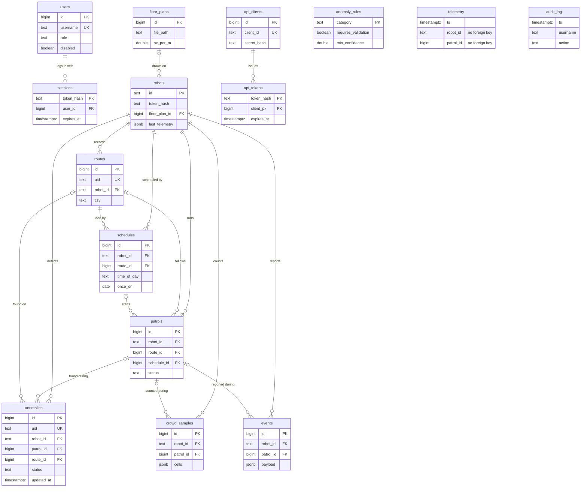

# Database

`netra-api` keeps its state in PostgreSQL. With TimescaleDB available, two tables become
hypertables; plain PostgreSQL works without it. Access goes through `database/sql` with the
`lib/pq` driver in [`internal/store`](../internal/store/store.go). Photos and floor-plan files live
on disk ([files outside the database](#files-outside-the-database)).

## How migrations are applied

Migrations are the SQL files in `internal/store/migrations/`, embedded into the binary with
`//go:embed migrations/*.sql`. `store.Open`:

1. opens the pool (`NETRA_DATABASE_URL`, at most 20 open connections) and pings the database up to
   31 times, one second apart, so `netra-api` can start before the database is ready;
2. creates `schema_migrations (name TEXT PRIMARY KEY, applied_at TIMESTAMPTZ NOT NULL DEFAULT now())`
   if needed;
3. sorts the embedded file names as strings and, for each name not yet in `schema_migrations`, runs
   the whole file as one statement batch inside a transaction and records the name in the same
   transaction.

Any error stops start-up (`netra-api` exits with status 1). Consequences:

- A migration runs once per database and is identified by its file name only; editing a file that
  was already applied has no effect on existing databases.
- There are no down migrations.
- Order is lexical, hence the zero-padded `NNN_` prefix.
- Most statements are idempotent (`IF NOT EXISTS`, `ON CONFLICT`), not all of them
  (`ADD CONSTRAINT users_role_check` in 002), so a migration must not be applied by hand before the
  service sees it.

## Overview

| Table | Holds | Written by |
|---|---|---|
| `users` | Dashboard accounts | Admin bootstrap at start-up, user routes, login (`last_login`) |
| `sessions` | SHA-256 digests of session tokens | Login, logout, user and password changes |
| `robots` | Registered robots, token digest, last telemetry | Robot routes, robot telemetry |
| `floor_plans` | Plan files and their calibration | Floor-plan routes |
| `routes` | Recorded routes with their CSV | Robot uploads; rename and archive routes |
| `schedules` | Weekly and one-off patrol schedules | Schedule routes; scheduler (`last_run_on`) |
| `patrols` | Patrol runs | Patrol start, robot `patrol_event`, command acks |
| `events` | Robot `patrol_event`, `stop_event` and `alert` messages | Robot WebSocket |
| `anomaly_rules` | What happens to each anomaly category | Seeds (001, 003), rule routes |
| `anomalies` | Detections: early and final result, status, validation, notification | Robot uploads, pipeline, validation |
| `crowd_samples` | Crowd windows with their grid cells | Robot WebSocket |
| `telemetry` | One history sample per robot every 5 s | Robot WebSocket |
| `audit_log` | User and integration actions | API ([audit log](architecture.md#audit-log)) |
| `api_clients`, `api_tokens` | Integration clients and their access tokens | API client routes, `/api/ext/v1/oauth/token` |

## Migrations

### 001_init.sql

[`001_init.sql`](../internal/store/migrations/001_init.sql) is the base schema. Foreign keys to
`robots` cascade on delete; references to patrols, routes, schedules and floor plans are set to
`NULL` when those rows are deleted (routes cascade into schedules).

**`users`**

| Column | Type | Notes |
|---|---|---|
| `id` | `BIGSERIAL` | Primary key |
| `username` | `TEXT` | Unique, not null |
| `password_hash` | `TEXT` | Not null; `pbkdf2-sha256$<iterations>$<salt>$<hash>` |
| `role` | `TEXT` | Not null, default `operator` |
| `created_at` | `TIMESTAMPTZ` | Default `now()` |

**`sessions`**

| Column | Type | Notes |
|---|---|---|
| `token_hash` | `TEXT` | Primary key; SHA-256 hex of the session token |
| `user_id` | `BIGINT` | References `users`, on delete cascade |
| `expires_at` | `TIMESTAMPTZ` | Not null |

**`floor_plans`**

| Column | Type | Notes |
|---|---|---|
| `id` | `BIGSERIAL` | Primary key |
| `name`, `file_path`, `content_type` | `TEXT` | Not null |
| `width_px`, `height_px` | `DOUBLE PRECISION` | Default 0 |
| `origin_x_px`, `origin_y_px` | `DOUBLE PRECISION` | Default 0; plan pixel of the map origin |
| `px_per_m` | `DOUBLE PRECISION` | Default 20 |
| `rotation_rad` | `DOUBLE PRECISION` | Default 0 |
| `created_at` | `TIMESTAMPTZ` | Default `now()` |

The column comment gives the transform: plan pixel = origin + scale · R(rotation) · (x, −y).

**`robots`**

| Column | Type | Notes |
|---|---|---|
| `id` | `TEXT` | Primary key, the robot ID |
| `name` | `TEXT` | Not null |
| `token_hash` | `TEXT` | Not null; SHA-256 hex of the robot token |
| `floor_plan_id` | `BIGINT` | References `floor_plans`, on delete set null |
| `last_seen` | `TIMESTAMPTZ` | Time of the last telemetry |
| `last_telemetry` | `JSONB` | Last telemetry message as sent |
| `created_at` | `TIMESTAMPTZ` | Default `now()` |

**`routes`**

| Column | Type | Notes |
|---|---|---|
| `id` | `BIGSERIAL` | Primary key |
| `uid` | `TEXT` | Unique, not null; the robot's route ID, makes uploads idempotent |
| `robot_id` | `TEXT` | References `robots`, on delete cascade |
| `name` | `TEXT` | Not null |
| `recorded_at` | `TIMESTAMPTZ` | Not null |
| `length_m` | `DOUBLE PRECISION` | Default 0 |
| `stops` | `INT` | Default 0 |
| `closed` | `BOOLEAN` | Default false |
| `csv` | `TEXT` | Not null; `x,y,yaw_deg,dwell_sec` rows |
| `archived` | `BOOLEAN` | Default false |
| `created_at` | `TIMESTAMPTZ` | Default `now()` |

**`schedules`**

| Column | Type | Notes |
|---|---|---|
| `id` | `BIGSERIAL` | Primary key |
| `robot_id` | `TEXT` | References `robots`, on delete cascade |
| `route_id` | `BIGINT` | References `routes`, on delete cascade |
| `name` | `TEXT` | Not null |
| `days` | `INT[]` | Not null; 0 = Sunday to 6 = Saturday |
| `time_of_day` | `TEXT` | Not null; `HH:MM` in the server time zone |
| `enabled` | `BOOLEAN` | Default true |
| `last_run_on` | `DATE` | Last day the schedule fired |
| `created_at` | `TIMESTAMPTZ` | Default `now()` |

**`patrols`**, index `patrols_robot_created (robot_id, created_at DESC)`

| Column | Type | Notes |
|---|---|---|
| `id` | `BIGSERIAL` | Primary key |
| `robot_id` | `TEXT` | References `robots`, on delete cascade |
| `route_id` | `BIGINT` | References `routes`, on delete set null |
| `schedule_id` | `BIGINT` | References `schedules`, on delete set null |
| `status` | `TEXT` | Default `requested`; `requested`, `running`, `finished`, `stopped`, `failed` |
| `message` | `TEXT` | Default `''` |
| `laps` | `INT` | Default 0 |
| `started_at`, `finished_at` | `TIMESTAMPTZ` | |
| `created_at` | `TIMESTAMPTZ` | Default `now()` |

**`anomaly_rules`**, seeded with `ON CONFLICT DO NOTHING`

| Column | Type | Notes |
|---|---|---|
| `category` | `TEXT` | Primary key |
| `label` | `TEXT` | Not null |
| `requires_validation` | `BOOLEAN` | Default true |
| `notify_telegram` | `BOOLEAN` | Default false |
| `telegram_chat_id` | `TEXT` | Default `''` (use `NETRA_TELEGRAM_CHAT_ID`) |
| `min_confidence` | `DOUBLE PRECISION` | Default 0.5 |

| Seed | Label | Requires validation | Telegram |
|---|---|---|---|
| `trash` | Sampah | false | true |
| `spill` | Tumpahan | false | true |
| `floor_damage` | Lantai Rusak | true | true |
| `fallen_person` | Orang Terjatuh | true | true |
| `unknown` | Lainnya | true | false |

**`anomalies`**, indexes `anomalies_status (status, created_at DESC)` and
`anomalies_detected (detected_at DESC)`

| Column | Type | Notes |
|---|---|---|
| `id` | `BIGSERIAL` | Primary key |
| `uid` | `TEXT` | Unique, not null; the robot's detection ID, makes uploads idempotent |
| `robot_id` | `TEXT` | References `robots`, on delete cascade |
| `patrol_id` | `BIGINT` | References `patrols`, on delete set null |
| `route_id` | `BIGINT` | References `routes`, on delete set null |
| `detected_at` | `TIMESTAMPTZ` | Not null |
| `early_category` | `TEXT` | Not null; the robot's category |
| `early_confidence` | `DOUBLE PRECISION` | Not null |
| `early_note` | `TEXT` | Default `''` |
| `final_category` | `TEXT` | Null until the final detection |
| `final_confidence` | `DOUBLE PRECISION` | |
| `final_note` | `TEXT` | Default `''` |
| `x`, `y`, `yaw` | `DOUBLE PRECISION` | Robot pose in the map frame |
| `stop_index` | `INT` | |
| `image_path` | `TEXT` | Not null; photo path on disk |
| `status` | `TEXT` | Default `queued` |
| `validated_by` | `TEXT` | |
| `validated_at`, `notified_at` | `TIMESTAMPTZ` | |
| `created_at` | `TIMESTAMPTZ` | Default `now()` |

The column comment on `status` (`queued -> analyzing -> needs_validation | notified | closed`)
predates the code; the statuses in use are `queued`, `analyzing`, `needs_validation`, `confirmed`,
`rejected` and `dismissed` ([pipeline](architecture.md#anomaly-pipeline)).

**`crowd_samples`**, index `crowd_time (ts_start)`

| Column | Type | Notes |
|---|---|---|
| `id` | `BIGSERIAL` | Primary key |
| `robot_id` | `TEXT` | References `robots`, on delete cascade |
| `patrol_id` | `BIGINT` | References `patrols`, on delete set null |
| `ts_start`, `ts_end` | `TIMESTAMPTZ` | Not null; the window, corrected to server time |
| `cell_size` | `DOUBLE PRECISION` | Not null; metres |
| `cells` | `JSONB` | Not null; `[[ix, iy, count], ...]` |
| `peak_people` | `INT` | Not null |

**`events`**, index `events_patrol (patrol_id, ts)`

| Column | Type | Notes |
|---|---|---|
| `id` | `BIGSERIAL` | Primary key |
| `robot_id` | `TEXT` | References `robots`, on delete cascade |
| `patrol_id` | `BIGINT` | References `patrols`, on delete set null |
| `type` | `TEXT` | Not null; `patrol_event`, `stop_event` or `alert` |
| `payload` | `JSONB` | Not null; the robot message |
| `ts` | `TIMESTAMPTZ` | Default `now()` (server time of arrival) |

### 002_rbac_audit_timeseries.sql

[`002_rbac_audit_timeseries.sql`](../internal/store/migrations/002_rbac_audit_timeseries.sql) adds
roles, session metadata, one-off schedules, the audit log and the telemetry history.

- `users`: every role other than `admin`, `supervisor`, `operator` and `viewer` becomes `admin`; new
  columns `display_name TEXT NOT NULL DEFAULT ''`, `disabled BOOLEAN NOT NULL DEFAULT false`,
  `last_login TIMESTAMPTZ`; constraint `users_role_check` limits `role` to the four roles.
- `sessions`: new columns `created_at TIMESTAMPTZ NOT NULL DEFAULT now()` and
  `ip TEXT NOT NULL DEFAULT ''`.
- `schedules`: new column `once_on DATE` (run once on that date instead of weekly); `days` defaults
  to `'{}'`.
- The comment at the top describes the supervisor as "operations + users read + audit"; the
  permissions actually granted are in [`rbac.go`](../internal/auth/rbac.go), where the supervisor has
  no `users` permission.

**`audit_log`** (no primary key), index `audit_ts (ts DESC)`

| Column | Type | Notes |
|---|---|---|
| `ts` | `TIMESTAMPTZ` | Not null, default `now()` |
| `username` | `TEXT` | Not null; `api:<client_id>` for integration clients, `-` when unknown |
| `action` | `TEXT` | Not null |
| `target` | `TEXT` | Not null, default `''` |
| `detail` | `JSONB` | Not null, default `'{}'` |
| `ip` | `TEXT` | Not null, default `''` |

**`telemetry`** (no primary key, no foreign keys), index `telemetry_robot_ts (robot_id, ts DESC)`

| Column | Type | Notes |
|---|---|---|
| `ts` | `TIMESTAMPTZ` | Not null; server time of the sample |
| `robot_id` | `TEXT` | Not null |
| `x`, `y`, `yaw` | `DOUBLE PRECISION` | Pose in the map frame |
| `battery` | `DOUBLE PRECISION` | Percent |
| `nav_state`, `mode` | `TEXT` | Not null, default `''` |
| `people` | `INT` | Not null, default 0 |
| `patrol_id` | `BIGINT` | |

The `DO` block at the end runs only when `timescaledb` is listed in `pg_available_extensions`:

- `CREATE EXTENSION IF NOT EXISTS timescaledb`;
- `telemetry` and `audit_log` become hypertables on `ts` (`migrate_data => TRUE`);
- retention policy: `telemetry` chunks older than 180 days are dropped;
- compression on `telemetry` (`compress_segmentby = 'robot_id'`) with a policy compressing chunks
  older than 7 days.

`audit_log` gets neither retention nor compression (the repository README says both tables do).
Because the extension is created whenever it is available, the database role must be allowed to
create it; if that fails, the migration fails and `netra-api` does not start. Without the extension
both tables stay plain tables.

### 003_english_defaults.sql

[`003_english_defaults.sql`](../internal/store/migrations/003_english_defaults.sql) changes the
seeded labels to English (`Trash`, `Spill`, `Floor damage`, `Fallen person`, `Other`), each only if
the label is still the Indonesian seed, so custom labels are kept. Translations of the built-in
categories for reports and Telegram come from [`i18n.go`](../internal/i18n/i18n.go).

### 004_robot_load.sql

[`004_robot_load.sql`](../internal/store/migrations/004_robot_load.sql) adds nullable
`DOUBLE PRECISION` columns to `telemetry` for the robot computer load: `cpu_percent`,
`gpu_percent`, `memory_percent`, `memory_used_gb`, `memory_total_gb`, `cpu_temp_c`.

### 005_api_clients.sql

[`005_api_clients.sql`](../internal/store/migrations/005_api_clients.sql) adds the integration API
clients, their tokens, and the change feed column on `anomalies`.

**`api_clients`**

| Column | Type | Notes |
|---|---|---|
| `id` | `BIGSERIAL` | Primary key |
| `client_id` | `TEXT` | Unique, not null; `nc_` and 16 hex digits |
| `name` | `TEXT` | Not null |
| `secret_hash` | `TEXT` | Not null; SHA-256 hex of the `ncs_` secret |
| `scopes` | `TEXT[]` | Not null, default `'{}'` |
| `enabled` | `BOOLEAN` | Not null, default true |
| `created_by` | `TEXT` | Not null, default `''` |
| `created_at` | `TIMESTAMPTZ` | Not null, default `now()` |
| `last_used_at` | `TIMESTAMPTZ` | Updated at most once a minute per client |

**`api_tokens`**, index `api_tokens_expiry (expires_at)`

| Column | Type | Notes |
|---|---|---|
| `token_hash` | `TEXT` | Primary key; SHA-256 hex of the `nat_` access token |
| `client_pk` | `BIGINT` | Not null; references `api_clients(id)`, on delete cascade |
| `scopes` | `TEXT[]` | Not null; scopes granted to this token |
| `expires_at` | `TIMESTAMPTZ` | Not null |

**`anomalies.updated_at`**

- Added as `TIMESTAMPTZ`, back-filled with the latest of `created_at`, `validated_at` and
  `notified_at`, then given the default `clock_timestamp()` and `NOT NULL`.
- Function `netra_touch_updated_at()` (PL/pgSQL) and trigger `anomalies_touch` (`BEFORE UPDATE`,
  for each row) set `updated_at` to `clock_timestamp()` on every update, so status changes, final
  detections, validations and notifications all move the row in the change feed.
- Index `anomalies_updated (updated_at, id)` serves the feed's keyset condition
  `(updated_at, id) > (cursor)` ([`feed.go`](../internal/store/feed.go)).

## Retention

- With TimescaleDB, `telemetry` rows older than 180 days are dropped and chunks older than 7 days
  are compressed.
- Expired `api_tokens` rows are deleted whenever a new token is issued.
- Nothing else is deleted automatically: patrols, events, anomalies (and their photos), crowd
  samples, `audit_log` and `sessions` (expired sessions included) grow until removed through the API
  or by hand. Deleting a robot cascades to its routes, schedules, patrols, anomalies, crowd samples
  and events, but not to `telemetry` rows or photo files.

## Files outside the database

| Path | Referenced by | Written by |
|---|---|---|
| `NETRA_DATA_DIR/anomalies/<YYYY-MM-DD>/<uid>.jpg` | `anomalies.image_path` | Robot anomaly upload; the date is the upload day in the process time zone |
| `NETRA_DATA_DIR/floorplans/<unix nanoseconds><ext>` | `floor_plans.file_path` | Floor-plan upload; deleted with the plan |

The stored paths are built from `NETRA_DATA_DIR` at upload time (relative paths stay relative to
the working directory). Back up the data directory together with the database, and keep
`NETRA_DATA_DIR` stable or rewrite the stored paths when moving it.
