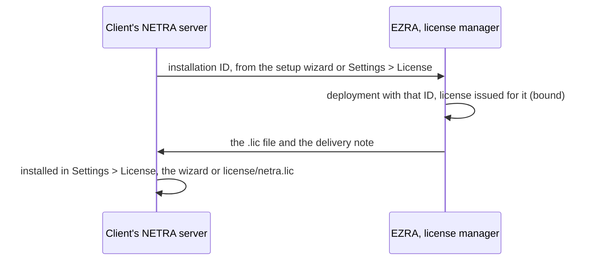

# License manager

The NETRA License Manager ([`cmd/netra-license-manager`](../cmd/netra-license-manager/main.go),
[`internal/licensemgr`](../internal/licensemgr/)) is EZRA Robotics' web tool to issue the signed
licenses NETRA servers accept ([licensing](licensing.md)). It keeps the clients and their
deployments, the signing key (encrypted with a passphrase), every license issued and an audit log,
all as files in one folder.

It is vendor-only: it signs every license, so it never goes to a client. It is not in the
`Dockerfile`, the CI images or the Netra compose. `netra-license` stays for scripts and CI; the
manager is the persistent, friendly version of `netra-license issue`.

## Run

```bash
make license-manager                       # -data ~/netra-licenses -addr 127.0.0.1:8099
go run ./cmd/netra-license-manager -data ~/netra-licenses -addr 127.0.0.1:8099
go build -o netra-license-manager ./cmd/netra-license-manager   # one binary, the UI inside
```

Then open <http://127.0.0.1:8099>. The UI is embedded (plain HTML, CSS and JavaScript, nothing
from a CDN), so the manager works offline.

| Flag | Default | Meaning |
|---|---|---|
| `-data` | `~/netra-licenses` | The data folder, created when missing |
| `-addr` | `127.0.0.1:8099` | Listen address |
| `-tls-cert`, `-tls-key` | none | Serve HTTPS with this certificate and key (PEM) |
| `-version` | | Print the version and exit |

Keep it on localhost. To reach it from another machine, tunnel it
(`ssh -L 8099:127.0.0.1:8099 <host>`) or serve it over TLS with `-tls-cert` and `-tls-key`; the
manager logs a warning when it listens beyond the machine without TLS.

Build the manager from the same commit as the `netra-api` release you issue for: it tells whether
its key is among the keys built into that commit (`internal/license/keys/*.pub`).

## First start

1. **The first operator.** A new data folder has no operator, so the UI asks for one (username of
   3 to 32 characters `a-z 0-9 . _ -`, password of at least 10 characters). After that the setup
   is closed; operators add each other on the Operators page. Do it right after the first start:
   until then whoever reaches the address can create it.
2. **The signing key.** Signing key > Generate a new key, or Import an existing key (the `.key` file
   of `netra-license keygen`). Import the key that already signs client licenses if there is one.
3. **Trust.** Copy the public key (or download `ezra-<fingerprint>.pub`) to
   `internal/license/keys/` and release `netra-api`. Until a release carries it, every netra-api
   refuses the manager's licenses; the dashboard, the issue form and the key page say so.

## The signing key

| | |
|---|---|
| File | `key.enc` in the data folder: the public key in clear, the 32-byte Ed25519 seed sealed |
| Encryption | PBKDF2-SHA256, 600,000 iterations, 16-byte salt, into an AES-256-GCM key; the public key is bound as additional data, so a swapped public key does not decrypt |
| Passphrase | At least 12 characters; asked to generate, import, unlock and change it |
| Unlocked | Per process, in memory only; locks itself after 30 minutes without signing, on Lock now and when the manager stops (the key bytes are wiped) |
| Never | Written in clear, logged, or sent to the browser |
| Wrong passphrases | Audited; after 8 within 10 minutes from one address, unlocking from it is refused for the rest of those 10 minutes |

The top bar shows the key's state: no key, locked, or unlocked with the minutes left. Issuing or
renewing with a locked key asks for the passphrase and continues.

**Change the passphrase** on the key page: the same key, encrypted again.

**Replace the key** (a leaked or lost passphrase, staff changes): the manager never replaces a key
from the UI, so a key that signed licenses cannot be lost by a click.

1. Stop the manager and move `key.enc` out of the data folder (keep it with the backups).
2. Start it, generate or import the new key, and add its `.pub` next to the old one in
   `internal/license/keys/`; release `netra-api`.
3. Renew every client license (Renew signs with the current key) and send them.
4. Remove the old `.pub` once every client runs a license of the new key
   ([keys/README.md](../internal/license/keys/README.md)).

## Activation, from the vendor side



1. The client installs NETRA. The setup wizard (and later Settings > License) shows the server's
   installation ID, such as `NETRA-7KQ3-M9XD-2WPA`.
2. The client sends the ID.
3. Clients > the client (New client first if needed) > Add deployment: the site's name and the ID.
   Case and look-alike letters do not matter (`O` for `0`, `I` and `L` for `1`); one ID belongs to
   one deployment only.
4. Issue on the deployment's row (or Issue license and choose the client and the deployment). The
   form shows the binding: the license works on that server only.
5. On the license page: Download .lic (`<client>-<YYYYMMDD>.lic`) and copy the delivery note, which
   says what the license includes and how to install it. Send the file attached; mail programs may
   wrap a pasted license text.
6. The client installs it in Settings > License or the setup wizard (no restart), or copies it to
   `license/netra.lic` and runs `docker compose up -d api`. No internet is needed.

A reinstalled server (a new database) has a new installation ID. Change the deployment's ID, then
Renew: a renewal follows the deployment's current ID. Leave a deployment's ID empty only for EZRA's
own cloud deployments: their licenses work on any server.

## Issuing, renewing, changing

The issue form:

| Field | What the license gets |
|---|---|
| Client, deployment | `client` (the client's name), `installation` (the deployment's ID; none without a deployment) |
| Edition, tier | `edition`, `tier` |
| Modules | Ticked from the edition and the tier; the license gets `license.Features(edition, tier, add, remove)` where `add` is what is ticked beyond the preset and `remove` what is unticked |
| Map mode | `map`, the edition's by default (mall floorplan, substation gps, custom floorplan) |
| Robot limit | `max_robots`, 0 for no limit |
| Validity | `expires_at`: a number of days from signing, the end of a chosen day (in the browser's time zone), or no expiry |
| Branding | `branding`: application name (up to 40 characters), light and dark colours, an SVG or PNG logo up to 256 KB embedded as a data URL |
| Note | Kept by the manager only, e.g. the purchase order |

`product` is always `netra`; the ID is the issue date and 48 random bits, as with
`netra-license issue`. The preview draws the login page and the dashboard in both themes with the
colours as the dashboard adjusts them (mixed towards black or white until 4.5:1 against each
theme's surface).

- **Renew** (license page): the same terms with new dates. The default keeps the license's length,
  counted from its expiry when it has not expired yet, so renewing early loses no days.
- **Change** (license page): the issue form, filled with the license's terms.

Renewals and changes record the license they replace. NETRA applies the newest valid license it is
given, so a replaced license is history: the list hides them unless asked, and the dashboard counts
only current ones. Statuses: valid, expiring (within 30 days), in grace (up to 14 days after the
expiry, modules still on) and expired.

## Verify

Paste any license text, or open a `.lic` file. The manager decodes the payload (also when no key
signed it), checks the signature against its own key and against the keys built into this build,
the status, the binding against an installation ID you give, and whether it issued that license
with exactly that text. A text with line breaks inside (a wrapped e-mail) is reported: netra-api
refuses it as it is.

## Operators, sessions and the audit log

- Operators sign in with a username and a password (PBKDF2-SHA256, as in netra-api). Every operator
  can do everything. Removing an operator ends their sessions; changing your password ends your
  other sessions.
- The session is an HttpOnly, `SameSite=Strict` cookie (`Secure` over TLS), valid 12 hours, kept in
  memory: a restart signs everyone out and locks the key.
- Requests that change something need the header `X-Netra-Manager: 1` and, when the browser sends
  one, an `Origin` of the manager's own host; anything else gets 403. A form or a script of another
  site cannot set the header without a CORS preflight, which the manager never grants.
- 8 failed logins in 10 minutes from one address block logins from it for the rest of the window.

`audit.log` has one JSON line per action: `time`, `user`, `action`, `target`, `detail`, `ip`.

| Action | When |
|---|---|
| `setup`, `login`, `login_failed`, `logout` | The first operator, sign-ins and sign-outs |
| `operator.create`, `operator.delete`, `password.change` | Operators |
| `key.generate`, `key.import`, `key.unlock`, `key.unlock_failed`, `key.lock`, `key.passphrase` | The signing key (`key.lock` with `reason` `manual` or `idle`) |
| `client.create`, `client.update`, `client.delete` | Clients |
| `deployment.create`, `deployment.update`, `deployment.delete` | Deployments, with their installation ID |
| `license.issue`, `license.renew`, `license.change` | Licenses: client, edition, tier, robots, installation, expiry, the license replaced |

The Audit log page lists and searches it; the dashboard shows the latest actions without
sign-ins and sign-outs.

## Data folder and backups

```text
~/netra-licenses/
├── key.enc              the signing key, encrypted
├── users.json           operators and their password hashes
├── clients/<id>.json    a client and its deployments
├── licenses/<id>.json   an issued license: payload, text, operator, note, the license it replaces
├── licenses/<id>.lic    the license text, as sent
├── audit.log            one JSON line per action
└── manager.lock         keeps a second manager off the folder
```

- Every JSON file carries `"schema": 1`. A file of a newer manager is refused instead of being
  rewritten without the fields this one does not know.
- Files are written atomically (a temporary file in the same folder, synced, renamed over the old
  one), with mode 0600; folders are 0700, the data folder too.
- One manager process uses a folder at a time. Several operators share one manager.

**Backup** is a copy of the folder, for example
`tar czf netra-licenses-$(date +%F).tgz -C ~ netra-licenses`. Writes are atomic, so a copy taken
while the manager runs is consistent file by file. Keep backups offline or encrypted: they hold the
client list and every license. `key.enc` is useless without the passphrase, so keep the passphrase
apart from the backups (a password manager or a sealed envelope).

**Restore**: stop the manager, put the folder back, start it, unlock the key.

Losing both `key.enc` (with its passphrase) and the original `.key` means no new license is accepted
until a `netra-api` release trusts a new key; the licenses already installed keep working.

## HTTP API

JSON under `/api/`, behind the session cookie (except the first three rows); the UI is served at
`/`. Errors are `{"error": "...", "field": "..."}` (400 for a form field); a locked key answers 423
with `"code": "key_locked"`, a missing key 409 with `"code": "no_key"`.

| Method | Path | |
|---|---|---|
| GET | `/api/session` | First run needed, the signed-in operator, the version |
| POST | `/api/setup` | The first operator `{username, password}` |
| POST | `/api/login` | `{username, password}`; sets the session cookie |
| POST | `/api/logout`, `/api/password` | Sign out; change your password `{current, new}` |
| GET, POST, DELETE | `/api/operators[/{name}]` | Operators |
| GET | `/api/meta` | Modules, editions, tiers, map modes, limits |
| GET | `/api/dashboard` | Counts, licenses needing attention, latest actions, key state |
| GET | `/api/audit?limit=` | The audit log, newest first |
| GET | `/api/key`, `/api/key/public` | Key state; the public key as a `.pub` file |
| POST | `/api/key/generate`, `/api/key/import`, `/api/key/unlock`, `/api/key/lock`, `/api/key/passphrase` | The signing key |
| GET, POST | `/api/clients`, `/api/clients/{id}` | Clients; one client with its licenses |
| PUT, DELETE | `/api/clients/{id}` | Change or remove a client (one with licenses stays) |
| POST, PUT, DELETE | `/api/clients/{id}/deployments[/{dep}]` | Deployments |
| GET | `/api/licenses?status=&client=&edition=&current=1` | Licenses: `status` valid, expiring, grace or expired; `current=1` without the replaced ones |
| POST | `/api/licenses` | Issue (or change, with `supersedes`) |
| GET | `/api/licenses/{id}`, `/api/licenses/{id}/file` | A license with its text; the `.lic` download |
| POST | `/api/licenses/{id}/renew` | `{validity, note}` |
| POST | `/api/verify` | `{text, installation}` |

`validity` is `{"mode": "days", "days": 365}`, `{"mode": "until", "until": "2027-11-04T23:59:59+07:00"}`
(RFC 3339, or a date for the end of that day in UTC) or `{"mode": "none"}`.
