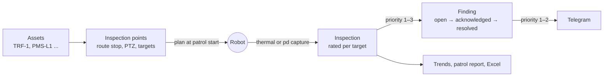

# Substation inspection

The module `substation` ([licensing](licensing.md#feature-modules)) turns NETRA into the ground
station of substation patrol robots: the equipment of the site, the inspection points a robot takes
on its route, what it measured there (thermal images and partial discharge), the priority of every
reading after ANSI/NETA, and the findings operators follow up until the repair. Positions are in the
robot map frame, so the module works with every [map mode](architecture.md#map-modes).



| Code | Role |
|---|---|
| [`internal/substation`](../internal/substation/) | The ratings (NETA table, partial discharge levels), point definitions and site settings; no database or HTTP |
| [`internal/store/substation.go`](../internal/store/substation.go) | Assets, points, inspections and findings; recording an inspection and its findings in one transaction |
| [`internal/api/substation.go`](../internal/api/substation.go) | Dashboard routes: assets, points, trends, inspections, findings, settings |
| [`internal/api/inspections.go`](../internal/api/inspections.go) | Robot routes (plan, upload), the evaluation of an upload, Telegram alerts |
| [`internal/api/substation_reports.go`](../internal/api/substation_reports.go) | Excel exports and the inspection part of the patrol report |
| [`009_substation.sql`](../internal/store/migrations/009_substation.sql) | The tables ([database](database.md#009_substationsql)) |

## Assets

An asset is a piece of equipment: a tag unique on the site (ignoring case, e.g. `TRF-1`), a name,
a kind, the bay, the voltage in kV, the phase, and optionally its position (`x`, `y` in map metres)
to draw it on the map.

Kinds: `transformer`, `breaker`, `disconnector`, `current_transformer`, `voltage_transformer`,
`surge_arrester`, `busbar`, `bushing`, `connector`, `cable_termination`, `capacitor`, `reactor`,
`insulator`, `other`.

Its condition is the most severe priority of its findings not resolved, with their number and the
time of the latest inspection of a point that measures it. An asset referred to by a point or a
finding cannot be deleted: archive it, which hides it from lists without losing its history.

## Inspection points

A point is where a robot inspects and what it measures:

| Field | |
|---|---|
| `kind` | `thermal` (a radiometric thermal camera) or `pd` (an acoustic camera for partial discharge); fixed once created |
| `route_id`, `stop_index` | The stop of a recorded route where the robot takes it: the rows of the route CSV with a dwell, counted from 0. The robot of that route takes it; the dashboard shows its stance (`x`, `y`, `yaw_deg`) |
| `seq` | Order among the points of one stop |
| `ptz` | The camera pose: `pan_deg` (-360 to 360), `tilt_deg` (-180 to 180), `zoom` (1 to 100, optical factor) |
| `asset_id` | The point's asset; a pd reading belongs to it, and thermal targets without their own asset do too |
| `settings` | Thermal: `reference` (below), `emissivity` (0.01–1) and `distance_m` for the robot's camera. Pd: `watch_db` and `alarm_db` instead of the site's levels |
| `targets` | Thermal only, 1 to 24: `key` (`a-z 0-9 _ -`, unique in the point), `label`, `asset_id`, `phase`, `group`, `roi` and `limit_c` |
| `enabled` | Disabled points leave the robot's plan and keep their history |

A target's `roi` is a rectangle of the thermal image as fractions of its width and height from the
top left (`{x, y, w, h}`); the robot reports the hottest temperature inside. Targets with the same
`group` are similar components under similar load, typically the three phases of a clamp, and are
compared with each other. `limit_c` is the component's rated temperature.

A point with inspections cannot be deleted: disable it.

## Thermal rating

NETRA rates every thermal target after ANSI/NETA MTS Table 100.18, "Thermographic Survey Suggested
Actions Based on Temperature Rise":

| Priority | Rise over a similar component | Rise over ambient air | Recommended action |
|---|---|---|---|
| 1 | > 15 °C | > 40 °C | Major discrepancy; repair immediately |
| 2 | | 21–40 °C | Monitor until corrective measures can be accomplished |
| 3 | 4–15 °C | 11–20 °C | Indicates probable deficiency; repair as time permits |
| 4 | 1–3 °C | 1–10 °C | Possible deficiency; warrants investigation |

For each target of a capture:

1. **Similar component.** A target of a group is compared with the coolest other member of its
   group read in the same capture: phases R 40.2, S 40.9, T 58.3 °C give T a rise of 18.1 °C over R
   (priority 1), and R and S nothing.
2. **Ambient.** When the robot reports `ambient_c`, every target also gets its rise over it.
3. **Reference.** The point's `reference` decides which rises rate the target: `auto` (the default)
   uses the similar component when the capture has one and the ambient air otherwise; `similar` and
   `ambient` use one only; `both` takes the more severe. Comparing with the ambient air alone rates
   loaded equipment in a hot climate severely, which is why `auto` prefers similar components.
4. **Rated temperature.** A reading at or above the target's `limit_c` is priority 1, whatever the
   reference.

Rises are rounded to 0.1 °C before rating. A band starts at its lower bound, so a rise between two
rows of the table (3.5 °C over a similar component) takes the less severe one. Both rises are kept
with every reading, and the inspection's priority is the most severe of its targets.

The table does not correct for load: heating grows with the square of the current, so a reading at
light load understates the rise. Read the trend of a point, not one capture.

## Partial discharge rating

An acoustic camera reports a level in dB, whether it detected a discharge, and sometimes its kind
(`corona`, `surface`, `floating`, `internal`). No standard sets acoustic levels, so the scale is
NETRA's own and the levels belong to the site and the instrument:

| Reading | Priority |
|---|---|
| No discharge detected | none |
| Detected below the watch level | 4 |
| From the watch level | 3 |
| From the alarm level | 2 |

The site levels are 10 dB (watch) and 20 dB (alarm) until an administrator changes them; a point may
set its own. Measure the background of the site during commissioning and set the levels above it.

## Findings

A finding is a deficiency of one target (of a pd point: its target is `pd`), followed from its first
abnormal reading until an operator resolves it.

- A reading rated at least as severe as the site's **finding priority** (3 by default) opens a
  finding, or updates the target's finding that is not resolved yet. Less severe readings keep
  their priority on the inspection and open nothing: a rise of 1 °C over a similar component
  (priority 4) is within the error of most cameras.
- A finding keeps the most severe priority seen while it is open (`priority`), the priority of the
  latest reading (`last_priority`, 0 when normal), the latest value and rise, and how many abnormal
  readings it had (`occurrences`).
- Events: `opened`; `seen` (abnormal again); `escalated` (more severe than before; an acknowledged
  finding opens again); `normal` (the latest reading opened nothing, the finding stays).
- Operators **acknowledge** an open finding (taken in hand, with a note such as a work order) and
  **resolve** it (repaired, or not a deficiency). A later abnormal reading of the target opens a
  new finding.
- A finding that opens or escalates at or above the site's **alert priority** (2 by default) is
  sent to Telegram with the thermal image (pd: the acoustic image), when the module
  `alerts.telegram` is licensed and a bot is configured.

### Site settings

`GET`/`PUT /api/v1/substation/settings`, stored in the `settings` table:

```json
{"finding_priority": 3, "alert_priority": 2, "pd": {"watch_db": 10, "alarm_db": 20}, "telegram_chat_id": ""}
```

`finding_priority` 1 to 4; `alert_priority` 0 (no alerts) or 1 to 4; `telegram_chat_id` empty sends
to `NETRA_TELEGRAM_CHAT_ID`. A `PUT` changes only the fields it sends.

## Robot protocol

The robot side of the module, in addition to the [robot endpoints](api.md#robot-endpoints).

**1. The plan.** On `start_patrol`, after downloading the route, the robot asks for its points:

```bash
curl -H "Authorization: Bearer $ROBOT_TOKEN" https://netra.example.com/api/v1/robot/routes/7/inspection
```

```json
{
  "route_id": 7,
  "points": [
    {"id": 3, "name": "Line 1 disconnector", "kind": "thermal", "stop_index": 0, "seq": 0,
     "ptz": {"pan_deg": -30, "tilt_deg": 12, "zoom": 4},
     "settings": {"reference": "auto", "emissivity": 0.95},
     "targets": [
       {"key": "r", "label": "Clamp R", "asset_id": 1, "phase": "R", "group": "clamp", "roi": {"x": 0.1, "y": 0.4, "w": 0.2, "h": 0.2}, "limit_c": null},
       {"key": "s", "label": "Clamp S", "asset_id": 1, "phase": "S", "group": "clamp", "roi": {"x": 0.4, "y": 0.4, "w": 0.2, "h": 0.2}, "limit_c": null},
       {"key": "t", "label": "Clamp T", "asset_id": 1, "phase": "T", "group": "clamp", "roi": {"x": 0.7, "y": 0.4, "w": 0.2, "h": 0.2}, "limit_c": null}
     ]},
    {"id": 4, "name": "Trafo 1 bushing PD", "kind": "pd", "stop_index": 1, "seq": 0, "ptz": null,
     "settings": {"watch_db": 12, "alarm_db": 20}, "targets": []}
  ]
}
```

Only enabled points with a stop are listed; pd points carry the levels in force. Another robot's
route is 403; without the module the plan is empty.

**2. At each stop**, for the points of that stop in `seq` order: turn the camera to `ptz`, let it
settle, capture, and for a thermal point measure the hottest temperature (and optionally the mean
and the coolest) inside each target's region. Apply the point's emissivity and distance when the
camera takes them.

**3. The upload** is multipart: `meta` (JSON) and the images `thermal`, `visual` and `acoustic`
(JPEG or PNG, 16 MiB each, all optional):

```json
{"uid": "f0b3c1d2-7a8e-4b1f-9c2d-3e4f5a6b7c8d", "point_id": 3, "ts": 1792113611.4, "patrol_id": 42,
 "pose": {"x": 10.0, "y": 0.1, "yaw": 1.57}, "ambient_c": 31,
 "thermal": [{"key": "r", "max_c": 40.2, "avg_c": 36.1}, {"key": "s", "max_c": 40.9}, {"key": "t", "max_c": 58.3}]}
```

| Field | |
|---|---|
| `uid` | Required, 1 to 128 of `A-Z a-z 0-9 . _ -`: repeated uploads of one uid keep the first (spool and retry freely) |
| `point_id` | Required; a point of another robot's route is 403 |
| `ts` | Unix seconds of the capture, corrected for the robot's clock offset; missing: the time of the upload |
| `patrol_id`, `pose` | Optional; the patrol counts the point as done |
| `ambient_c` | Optional, -60 to 80 °C: the air temperature, for the rise over ambient |
| `thermal` | Thermal points: `{key, max_c, avg_c?, min_c?}` per target, -60 to 2000 °C; keys the point does not define are ignored |
| `pd` | Pd points: `{db, detected, kind?}`, `db` from -20 to 200 |

The answer is 201 `{id, created, priority}`; without the module 202
`{id: 0, created: false, dropped: "feature not licensed"}`, so the robot can drop it from its spool.

**4. Take a point now.** `POST /api/v1/substation/points/{id}/inspect` sends the command
`inspect_point` to the robot of the point's route, with the point as in the plan under `args.point`.
The robot acks it (`ok: false` with a message when it cannot, for example while patrolling), takes
the point where it stands and uploads the inspection without a `patrol_id`.

## Reports

- **Patrol report** (`GET /api/v1/reports/patrols/{id}/pdf`): with the module, an Inspections part
  with the coverage of the route's plan (planned, done, missed, the most severe priority), every
  reading, and the images of the rated captures.
- **Findings** (`GET /api/v1/reports/substation/findings`, module `reports.export` too): Excel with
  the filters of the findings list.
- **Readings** (`GET /api/v1/reports/substation/inspections`): Excel with a row per thermal target
  or pd reading in the period.

`GET /api/v1/patrols/{id}` adds the coverage under `recap.inspections`
(`{planned, done, inspections, priority, missed}`).
